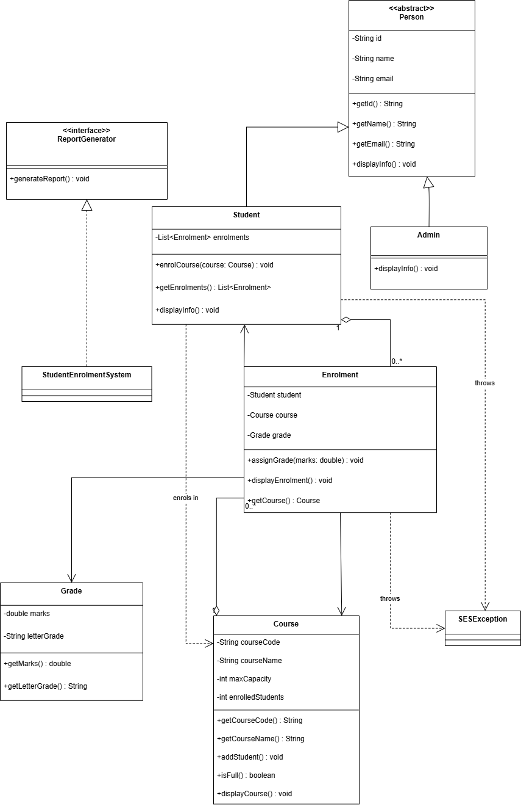
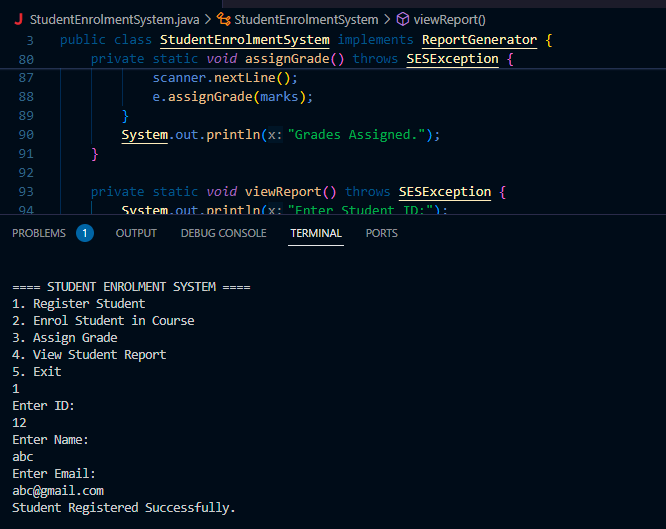
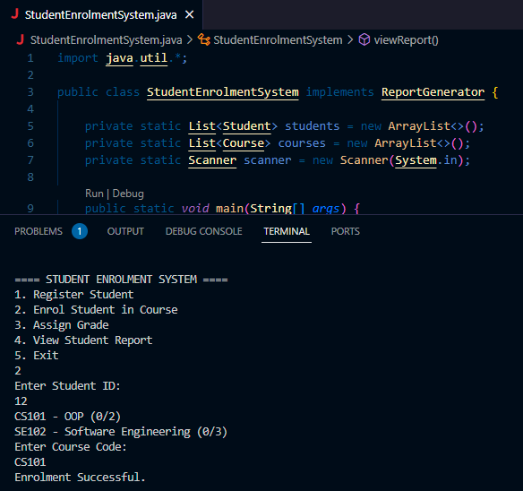
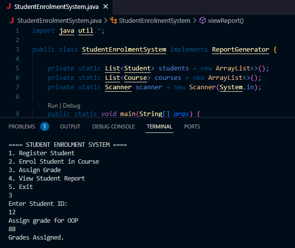
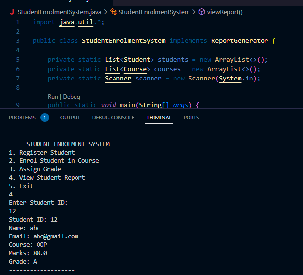

# Student Enrolment System (Java, OOP)

A console application that manages student registration, course enrolment, grading and reports. Built in Java to demonstrate the four pillars of object-oriented programming.

> University coursework: *Object-Oriented Programming*, BSc (Hons) Computing at Regent College London.

## Features

- Register students (ID, name, email)
- Enrol students on courses, with a maximum capacity per course
- Assign marks and automatically calculate a letter grade (A–F)
- View a student report with every enrolment and grade
- Validation with a custom exception (`SESException`) for unknown students, full courses and invalid marks

## OOP concepts demonstrated

| Concept | Where |
|---|---|
| **Abstraction** | `Person` is an abstract class with the abstract method `displayInfo()` |
| **Inheritance** | `Student` and `Admin` extend `Person` |
| **Polymorphism** | `displayInfo()` is overridden differently in `Student` and `Admin` |
| **Encapsulation** | All fields are `private` and accessed through getters |
| **Interfaces** | `StudentEnrolmentSystem` implements `ReportGenerator` |
| **Exception handling** | `SESException` for business-rule errors |

## Class diagram



More diagrams: [sequence diagram](docs/images/sequence-diagram.png) · [activity diagram](docs/images/activity-diagram.png)

## How to run

Requires Java 17 or later.

```bash
cd src
javac *.java
java StudentEnrolmentSystem
```

## Demo

| Register | Enrol | Grade | Report |
|---|---|---|---|
|  |  |  |  |

## Project structure

```
src/
├── Person.java                  # abstract base class
├── Student.java                 # extends Person, holds enrolments
├── Admin.java                   # extends Person
├── Course.java                  # course code, name, capacity
├── Enrolment.java               # links a Student to a Course and a Grade
├── Grade.java                   # marks → letter grade, with validation
├── ReportGenerator.java         # interface
├── SESException.java            # custom exception
└── StudentEnrolmentSystem.java  # main menu
```

## Possible improvements

- Save data to a file or database so it is kept between runs
- Stop a student enrolling on the same course twice
- Handle non-numeric menu input without crashing
- Add JUnit tests

## Author

**Gabriel Malini Rodrigues** · [LinkedIn](https://www.linkedin.com/in/gabriel-malini)
